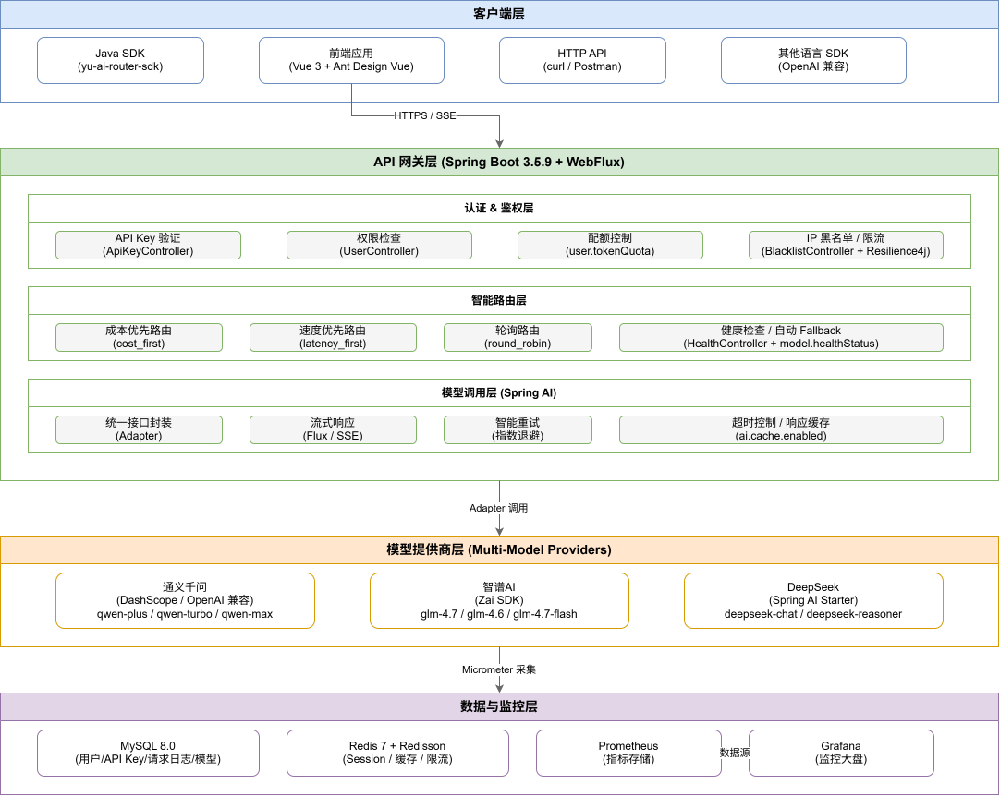

# AI-Router AI网关平台🚀

> **项目简介**：一个参考 OpenRouter.ai 设计的企业级 AI 网关平台。通过统一的 OpenAI 兼容接口，将通义千问、智谱AI、DeepSeek 等多个主流大模型封装为可互换的"模型池"，实现智能路由、自动故障转移、全链路监控与 Java SDK 支持，让开发者用一行代码即可在多个模型之间自由切换，而无需关心底层差异。

## 📍 1. 项目背景与痛点

在 AI 应用开发与企业内部落地场景中，开发者通常面临三个痛点：

| 痛点 | 具体表现 | 业务影响 |
| :--- | :--- | :--- |
| **多模型接入成本高** | 各家厂商的 SDK、鉴权方式、请求格式各不相同。 | 切换模型意味着重写业务代码，迁移成本极高。 |
| **单点故障风险大** | 某个模型服务宕机或触发限流时，业务直接中断。 | 缺乏自动降级与 Fallback 机制，服务可用性无法保障。 |
| **成本与调用不可见** | Token 消耗、费用、延迟分散在各家控制台。 | 难以统一核算与优化，成本不可控。 |

本项目旨在打造一个**企业级 AI 网关**，将多模型接入、路由调度、监控告警等横切关注点从业务代码中剥离。业务方只需对接一个 OpenAI 兼容接口，即可获得高可用、可观测、可优化的模型调用能力。

## 🎥 2. 演示与效果预览

> *(这里留给你插入视频和截图)*
> * **📺 视频演示**：*(建议录制一段 2 分钟视频，展示：前端创建 API Key ➔ 发起对话请求 ➔ 观察流式响应 ➔ 在监控大盘查看指标)*
> * **📸 界面截图**：
>   * *(图 1：API Key 管理页面，展示创建/撤销与调用统计)*
>   * *(图 2：Grafana 监控大盘，展示 QPS、成功率、延迟分布)*

## ✨ 3. 核心功能

* 🔌 **OpenAI 兼容接口**：`/v1/chat/completions` 完全兼容 OpenAI SDK 格式，已有代码改一个 `base_url` 即可接入。
* 🤖 **多模型统一接入**：通过 Spring AI 适配器封装通义千问、智谱AI、DeepSeek，统一请求与响应格式，支持流式响应与多轮对话。
* 🎯 **智能路由与自动 Fallback**：基于数据库 `model` 表权重实现策略路由，模型故障时自动切换备用模型，配合指数退避重试。
* 📊 **全链路监控**：基于 Micrometer + Prometheus 导出 QPS、成功率、延迟、Token 消耗等指标，预置 Grafana 仪表盘。
* 🔑 **API Key 与配额管理**：支持创建、查看、撤销 API Key（`ApiKeyController`），按 Key 统计调用量与 Token 消耗。
* 🛡️ **安全防护**：支持 IP 黑名单（`BlacklistController`）、双层限流（Resilience4j）、TraceId 全链路追踪。
* 🗝️ **BYOK 支持**：用户可自带厂商 API Key 直连模型（`UserProviderKeyController`），网关只做路由不做转发计费。
* 🔌 **插件系统**：内置 Web 搜索（SerpApi）、PDF 解析（PDFBox）、图片识别三大插件。
* 🖼️ **AI 绘图**：支持通义万相、智谱 CogView 文生图（`ImageController`）。


## 🏗️ 4. 系统架构设计


系统采用**分层架构**，各层职责与核心模块如下：

| 架构分层 | 核心职责 | 关键组件 / 实现 |
| :--- | :--- | :--- |
| **客户端层** | 统一通过 OpenAI 兼容接口接入网关 | Java SDK、前端应用、HTTP API |
| **认证鉴权层** | API Key 验证、权限检查、配额控制 | `ApiKeyController`、`UserController` |
| **智能路由层** | 成本/速度/轮询策略、健康检查、自动 Fallback | `HealthController`、`ModelController`、`ModelProviderController` |
| **模型调用层** | 统一接口封装、流式响应、智能重试、响应缓存 | Spring AI、`ChatController`、`ai.cache.enabled` |
| **模型提供商** | 底层大模型能力支撑 | 通义千问（DashScope）、智谱AI（Zai SDK）、DeepSeek |
| **监控链路** | 指标采集、存储与可视化 | Micrometer ➔ Prometheus ➔ Grafana |

## 🛠️ 5. 技术栈

| 模块 | 技术 / 组件 | 版本 / 说明 |
| :--- | :--- | :--- |
| **后端框架** | Spring Boot / Spring WebFlux / Spring AOP | 3.5.9 / 响应式流支持 |
| **AI 集成** | Spring AI / DashScope Starter / Zai SDK | 1.1.2 / 1.1.0.0-RC2 / 0.3.0 |
| **ORM 框架** | MyBatis-Flex | 1.11.1（含 Codegen） |
| **存储与缓存** | MySQL / Redis + Redisson / Spring Session | 8.0+ / 7+ / 3.52.0 |
| **高可用** | Resilience4j | 2.2.0（熔断器 / 限流） |
| **监控告警** | Actuator / Micrometer / Prometheus / Grafana | - |
| **API 文档** | Knife4j | 4.4.0（OpenAPI 3） |
| **工具库** | Hutool / PDFBox | 5.8.43 / 3.0.3（PDF 解析插件） |
| **前端框架** | Vue / Vite / Ant Design Vue / Pinia | 3.5.17 / 7.0.0 / 4.2.6 / 3.0.3 |
| **前端图表** | ECharts / marked / TypeScript | 5.5.0 / 17.0.1 / 5.8.0 |
| **部署基建** | Docker / Docker Compose / Nginx | - |

## 🧠 6. 核心设计取舍与难点攻克

| 核心难点 | 应对方案（解法） | 最终效果 |
| :--- | :--- | :--- |
| **多厂商模型接口差异大** | 基于 Spring AI `ChatModel` 抽象，为各厂商实现独立 Adapter，网关层统一请求/响应 DTO。 | 新增厂商只需实现 Adapter，业务代码零改动。 |
| **模型故障导致业务中断** | 内置健康检查与 Fallback 链，调用失败时按 `model.priority` 自动切换，配合指数退避重试。 | 高可用保障，`isFallback` 落库便于复盘。 |
| **Token 消耗与费用不可控** | 统一拦截响应，解析各厂商 `usage` 字段，归一化后入库并导出至 Prometheus。 | Grafana 多维聚合展示，成本清晰可见。 |
| **流式响应与监控采集冲突** | 采用 WebFlux `Flux` 返回流数据，在 `doOnComplete` 时异步记录指标，不阻塞输出。 | 通过 `traceId` 串联全链路排查问题。 |
| **多租户限流与配额公平性** | Resilience4j + Redis 实现 API Key 与 IP 双层限流，配额计数存 Redis。 | 分布式一致性保障，IP 黑名单入口拦截。 |

## 🚀 7. 快速开始

1. **环境准备**：JDK 21+、Node.js 22+、MySQL 8.0+、Redis 7.0+
2. **初始化数据库**：
   ```bash
   mysql -u root -p < sql/create_table.sql
   ```
3. **配置环境变量**：修改 `application-local.yml` 填入密钥（默认走通义千问 OpenAI 兼容模式），并配置 SerpApi Key：
   ```yaml
   spring:
     ai:
       openai:
         base-url: https://dashscope.aliyuncs.com/compatible-mode
         api-key: ${QWEN_API_KEY:YOUR_QWEN_API_KEY}
   ```
4. **启动后端**：执行 `./mvnw spring-boot:run`，访问接口文档：http://localhost:8123/api/doc.html
5. **启动前端**：执行 `cd frontend && npm install && npm run dev`，访问页面：http://localhost:5173
6. **Docker 部署（可选）**：执行 `docker-compose up -d`。

**Docker 部署服务端口一览**：

| 服务 | 访问地址 |
| :--- | :--- |
| 前端页面 | http://localhost |
| 后端 API | http://localhost:8123/api |
| Prometheus | http://localhost:9090 |
| Grafana | http://localhost:3000 (admin/admin) |

## 📡 8. API 使用示例

**对话接口（兼容 OpenAI 格式）**：

```bash
curl -X POST "http://localhost:8123/api/v1/chat/completions" \
  -H "Content-Type: application/json" \
  -H "Authorization: Bearer sk-your-api-key" \
  -d '{
    "model": "qwen-plus",
    "messages": [{"role": "user", "content": "你好"}],
    "stream": true
  }'
```

**智能路由（auto 模式）**：

```bash
curl -X POST "http://localhost:8123/api/v1/chat/completions" \
  -H "Authorization: Bearer sk-your-api-key" \
  -d '{
    "model": "auto",
    "messages": [{"role": "user", "content": "你好"}],
    "routing_strategy": "cost_first"
  }'
```

**Java SDK**：

```java
YuAIClient client = YuAIClient.builder()
    .apiKey("sk-your-api-key")
    .baseUrl("http://localhost:8123/api")
    .build();

// 同步调用
String response = client.chat("你好");          

// 流式调用
client.chatStream("讲一个故事", new StreamCallback() { ... });  
```

## 🔮 9. 未来迭代方向

| 迭代方向 | 具体规划说明 |
| :--- | :--- |
| **Function Calling 支持** | 统一编排各厂商的 Function Calling / Tool Use 能力，不仅限于转发对话。 |
| **Critic 模型评审** | 在路由层引入独立评审模型，对高风险请求响应打分，低于阈值自动切换。 |
| **多语言 SDK** | 在 Java SDK 基础上补充 Go / Python SDK，降低非 JVM 技术栈接入成本。 |
| **MCP 协议支持** | 将插件系统重构为 MCP Server，实现与 Cursor / Claude Desktop 无缝集成。 |
| **成本预算与告警** | 支持按 API Key 设置月度预算，超阈值自动降级到低成本模型或告警。 |

---
